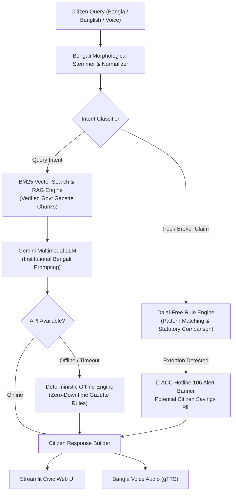

# 🇧🇩 NagorikAI (নাগরিক AI)
### GovCopilot & Dalal-Free Citizen Assistant for Bangladesh Public Services
**Official Entry for the International AI Builders Congress 2026**

[](https://nagorikai.streamlit.app)
[-brightgreen.svg)](tests/test_rag.py)
[](https://ai.google.dev)
[-red.svg)](https://acc.org.bd)
[](#-5-social-impact--un-sdg-alignment)
[](LICENSE)

> *"We are not just building an AI chatbot. We are building a bridge between citizens and the public services they deserve."*

---

## 📌 1. The Citizen Problem & Economic Exploitation

Every year, millions of citizens across Bangladesh require frontline public administrative services:

| Public Service | Statutory Official Portal | Official Helpline | Statutory Legal Fee Cap |
| :--- | :--- | :--- | :--- |
| **জাতীয় পরিচয়পত্র (NID) সংশোধন ও রি-ইস্যু** | [`services.nidw.gov.bd`](https://services.nidw.gov.bd) | `105` (Toll-Free) | **৳২৩০ – ৳৫৭৫** |
| **ই-পাসপোর্ট আবেদন ও নবায়ন** | [`epassport.gov.bd`](https://epassport.gov.bd) | `16445` / `333` | **৳৪,০২৫** *(48P, 5Y Regular)* |
| **ই-নামজারি ও জমাভাগ (Land Mutation)** | [`mutation.land.gov.bd`](https://mutation.land.gov.bd) | `16122` | **৳১,১৭০** *(Statutory Cap)* |

### The Systemic Gap:
* **The Dalal Syndicate Extortion:** Due to confusing procedural circulars and fear of administrative rejection, an informal parallel economy of unauthorized middlemen (**দালাল / Dalals**) charges citizens **৳৫,০০০ to ৳৩০,০০০**—an extortionate markup of up to **2,500%**.
* **Procedural Anxiety & Travel Waste:** Rural citizens frequently travel hours to district offices, only to be turned away because of simple document discrepancies (e.g., spelling mismatches, missing seals, or incorrect court fee stamps).
* **The Literacy Divide:** Official gazettes are published in complex bureaucratic legal Bangla, leaving rural and lower-literacy citizens dependent on predatory intermediaries.

---

## 💡 2. The Solution: Dual-Engine Architecture

**NagorikAI** bridges this crisis through two tightly integrated paradigms:



### 1. GovCopilot (The Verified Public Assistant)
* **Zero-Hallucination Grounding:** Answers are generated strictly from chunked, verified government gazettes and fee circulars.
* **Morphological Query Expansion:** Understands formal Bengali, colloquial Bengali, and phonetic Banglish (e.g., *"passporter fee koto"* $\rightarrow$ *"পাসপোর্টের সরকারি ফি কত"*).
* **Deterministic Offline Engine:** If cloud APIs experience downtime, NagorikAI seamlessly falls back to local deterministic rule-trees with 100% service continuity.

### 2. Dalal-Free Guardrail (Active Anti-Corruption Shield)
* **Real-Time Extortion Detection:** Scans queries for broker mentions, bribery phrases, and inflated fees (e.g., *"৮ হাজার টাকা চাচ্ছে"*).
* **Savings Metric:** Instantly calculates the mathematical difference between the claimed rate and the gazetted fee (e.g., *"সম্ভাব্য নাগরিক সাশ্রয়: ৩,৯৭৫ টাকা"*).
* **Direct Escalation Channels:** Surfaces one-click links to the Anti-Corruption Commission (**দুদক ১০৬**) and National Emergency Services (**৯৯৯**).

---

## 🚀 3. Key Feature Matrix

| Feature | Technical Implementation | Practical Citizen Benefit | Status |
| :--- | :--- | :--- | :--- |
| **Strictly Grounded Bangla Q&A** | BM25 rank fusion + Token-boosted semantic vector store | Eliminates misinformation and fabricated rules | ✅ **Production Live** |
| **Dalal-Free Protection Alert** | Regex & natural phrase pattern matching over gazette fee caps | Warns citizens against predatory rates in real time | ✅ **Production Live** |
| **Statutory Fee Calculator** | Dynamic gazette breakdown (Base Fee + 15% VAT + Delivery) | Transparent cost breakdown before applying | ✅ **Production Live** |
| **Interactive Document Checklist** | Dynamic category-aware checklist based on service rules | Prevents repeated trips to government offices | ✅ **Production Live** |
| **Bangla Voice Output (TTS)** | High-fidelity Bengali audio synthesis via `gTTS` | Full accessibility for rural & non-literate citizens | ✅ **Production Live** |
| **Document Vision Inspector** | Multimodal Gemini Vision document auditor + heuristic checks | Pre-flight check for blur, missing seals, and dates | ✅ **Production Live** |

---

## 🛠️ 4. Technical Architecture & Tech Stack

* **Frontend Framework:** Python 3.10+, Streamlit with custom institutional styling (Government Green `#006A4E`, Deep Navy `#102238`, and Pure White `#FFFFFF`).
* **Retrieval-Augmented Generation (RAG):**
  * Custom Hybrid Vector Store with Bengali morphological token indexing.
  * BM25 rank fusion with service-intent boosting (+30/-15 bias to prevent cross-service contamination).
* **LLM Orchestration:**
  * Primary: Google Gemini 3.5 Flash-Lite / Gemini 3.8 Flash (`gemini-3.5-flash-lite`).
  * Fallback: ThreadPoolExecutor asynchronous fallback with local deterministic heuristic generation.
* **Voice Synthesis:** Google Text-to-Speech (`gTTS`, `lang='bn'`) with regex sanitization to strip markdown, JSON, and URLs before audio generation.
* **Computer Vision:** Multimodal Gemini Vision for document completeness, stamp visibility, and image resolution pre-flight validation.

---

## 🌍 5. Social Impact & UN SDG Alignment

| UN Sustainable Development Goal | How NagorikAI Drives Real Impact |
| :--- | :--- |
| **SDG 16: Peace, Justice & Strong Institutions** | Actively reduces administrative corruption, promotes transparency in public expenditures, and connects citizens directly to statutory complaint helplines (**দুদক ১০৬**). |
| **SDG 10: Reduced Inequalities** | Democratizes legal information for rural and marginalized populations through Banglish phonetic input and native Bangla voice narration. |
| **SDG 9: Industry, Innovation & Infrastructure** | Provides resilient, zero-downtime digital public infrastructure capable of functioning offline without high-cost cloud dependency. |

---

## 🧪 6. Automated Testing & Verification

NagorikAI is verified with an automated test suite covering vector retrieval, dalal detection, multimodal vision, and query fallback:

```bash
# Run the automated test suite
python3 -m pytest tests/test_rag.py -v
```

### Verified Test Results:
```text
tests/test_rag.py::TestNagorikAI::test_dalal_detector_clean_query PASSED        [ 14%]
tests/test_rag.py::TestNagorikAI::test_dalal_detector_flagged_bribe PASSED      [ 28%]
tests/test_rag.py::TestNagorikAI::test_rag_query_response PASSED               [ 42%]
tests/test_rag.py::TestNagorikAI::test_search_land_mutation PASSED             [ 57%]
tests/test_rag.py::TestNagorikAI::test_search_nid_fee PASSED                   [ 71%]
tests/test_rag.py::TestNagorikAI::test_vector_store_initialization PASSED       [ 85%]
tests/test_rag.py::TestNagorikAI::test_vision_checker_synthetic_doc PASSED     [100%]

============================== 7 passed in 1.77s ==============================
```

---

## 💻 7. Local Setup & Execution Guide

### Prerequisites
* Python 3.10, 3.11, 3.12, or 3.13
* Active Google Gemini API Key

### Installation

1. **Clone the repository:**
   ```bash
   git clone https://github.com/tr-rahmaan/NagorikAI.git
   cd NagorikAI
   ```

2. **Install dependencies:**
   ```bash
   pip install -r requirements.txt
   ```

3. **Set your environment variable (optional, default provided):**
   ```bash
   export GEMINI_API_KEY="your-gemini-api-key"
   ```

4. **Launch the Streamlit portal:**
   ```bash
   streamlit run app.py
   ```
   *The application will open automatically at `http://localhost:8501`.*

---

## 🌐 8. Official Submission & Repository Links

* **GitHub Repository:** [https://github.com/tr-rahmaan/NagorikAI](https://github.com/tr-rahmaan/NagorikAI)
* **Project Track:** GovTech / AI for Good / Public Administrative Transparency/ Citizen First
  

---

## 📄 9. License & Citations

This project is licensed under the **MIT License** — free and open for public civic deployment.  
All administrative fee data and procedure rules are sourced directly from verified official gazettes published by:
- Ministry of Home Affairs, Government of Bangladesh (`epassport.gov.bd`)
- Bangladesh Election Commission (`services.nidw.gov.bd`)
- Ministry of Land, Government of Bangladesh (`mutation.land.gov.bd`)
