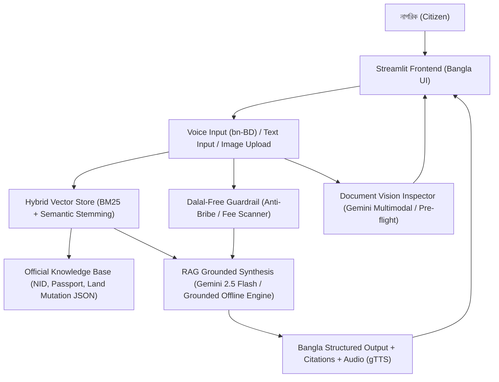

# 🇧🇩 CivicSphere AI (GovCopilot & Dalal-Free)

**A Bangla AI Assistant that provides citizens with exact, official guidance for government services, so they stop paying middlemen.**

---

## 🌟 Overview & Core Vision
In Bangladesh, ordinary citizens often lose between **৳৮,০০০ to ৳৫০,০০০** to unauthorized middlemen (*দালাল*) simply because official processes for **NID correction**, **e-Passport application**, and **Land Mutation (ই-নামজারি)** feel scattered, opaque, or intimidating. A single missing document often forces applicants to start over.

**CivicSphere AI combines two powerful paradigms:**
1. **GovCopilot (The Working MVP):** A Bangla conversational AI grounded exclusively in authentic government data with official URL citations and document checklists.
2. **Dalal-Free (The Vision & Guardrail):** An active anti-corruption guardrail that flags unofficial fees, calculates citizen savings against extortionate broker rates, and links directly to official hotlines (`106` ACC, `16122` Land, `105` NID, `333` Citizen Service).

---

## 🎯 3 Official Citizen Services Supported
1. **জাতীয় পরিচয়পত্র (NID) সংশোধন ও রি-ইস্যু** (`services.nidw.gov.bd` | Helpline: `105`)
   - Category A, B, C corrections, 1st/2nd time fee breakdowns (৳২৩০, ৳৩৪৫, ৳৫৭৫), required SSC/birth certificates, magistrate affidavits.
2. **ই-পাসপোর্ট আবেদন ও নবায়ন** (`epassport.gov.bd` | Helpline: `16445` / `333`)
   - 48 & 64 pages (5 & 10 years regular/express/super-express), document lists, attestation/photo myth-busting.
3. **ই-নামজারি ও জমাভাগ (Land Mutation)** (`mutation.land.gov.bd` | Helpline: `16122`)
   - Total official fee strictly capped at **৳১,১৭০** (৳৭০ application + ৳১,১০০ DCR/record correction), required deeds, CS/SA/RS khatian, up-to-date tax receipts.

---

## 🚀 Key Features

| Feature | Description | Status |
|---|---|---|
| **Bangla Q&A with strict grounding** | Answers derived purely from verified government JSON chunks; strict refusal if out-of-scope | ✅ **Live (MVP)** |
| **Official Citations** | Clickable government URL links and toll-free hotlines for every query | ✅ **Live (MVP)** |
| **Dalal-Free Protection Alert** | Proactively detects broker rates, extra fees, or bribe mentions; triggers prominent red alert banner | ✅ **Live (MVP)** |
| **Fee Calculator & Savings Metric** | Interactive calculator comparing official government fees vs. broker demands | ✅ **Live (MVP)** |
| **Live Document Checklist** | Interactive checkbox list tailored to the user's specific application category | ✅ **Live (MVP)** |
| **Voice Input in Bangla** | In-browser Web Speech API speech-to-text (`bn-BD`) | ✅ **Live (MVP)** |
| **Bangla Voice Output (TTS)** | Natural Bangla voice audio playback via gTTS for rural/low-literacy accessibility | ✅ **Live (MVP)** |
| **Document Vision Inspector** | Multimodal AI pre-flight audit for uploaded NID, passport slips, certificates, and deeds | ✅ **Live Demo** |
| **Roadmap Previews** | Automated form pre-fill and waiting-time estimator | 🧭 **Roadmap** |

---

## 🛠️ Architecture & Tech Stack



- **Frontend & App:** Python 3, Streamlit (Custom styled for Bangladesh Civic theme)
- **Vector Search & Retrieval:** Hybrid Vector Store with Bengali morphological stemmer & BM25 rank fusion
- **LLM / Generation:** Google Gemini (`gemini-2.5-flash`), OpenAI (`gpt-4o-mini`), or Grounded Deterministic Engine (zero-downtime offline fallback)
- **Voice & Speech:** HTML5 Web Speech API (`bn-BD`) + `gTTS` (`lang='bn'`)
- **Vision:** Multimodal Gemini Vision document auditor + local pre-flight heuristic checks

---

## 💻 How to Run Locally

### 1. Prerequisites
Ensure Python 3.10+ is installed on your machine. All required packages (`streamlit`, `numpy`, `pillow`, `gTTS`, `google-genai`, `openai`) are already installed in your current environment!

### 2. Run the Application
From the project folder:
```bash
streamlit run app.py
```
Your browser will open automatically at `http://localhost:8501`.

### 3. Run Automated Tests
```bash
python3 tests/test_rag.py
```

---

## 📝 Competition Submission Fields (Form Drafts)

- **Project Name:** CivicSphere AI
- **Elevator Pitch:** A Bangla AI assistant that gives citizens exact, official guidance for government services, so they stop paying middlemen.
- **Public Summary:** Citizens often pay middlemen for NID corrections, passports and land mutation because the process is confusing and one missing document means starting over. CivicSphere AI answers in Bangla, gives the exact document checklist and official fees, flags unofficial charges, and checks documents before submission.
- **Problem Statement:** Complex, scattered procedures lead to rejected applications, wasted time, and millions of Takas lost to corrupt middlemen.
- **Solution Description:** A Bangla RAG chatbot grounded strictly in official government sources. It returns step-by-step checklists with citations, warns about unofficial fees, supports voice input, and uses vision to catch document errors before submission.
- **Data & AI Provenance:** 
  - Official Government Portals: `services.nidw.gov.bd`, `epassport.gov.bd`, `mutation.land.gov.bd`
  - Hotlines: 105, 16445, 16122, 106 (ACC), 333
  - LLM: Google Gemini 2.5 Flash / OpenAI GPT-4o-mini
  - Strict grounding constraint: Answers are restricted strictly to retrieved official context; out-of-domain queries trigger a safe refusal and official hotline recommendation.
- **Tooling & IDE:** Python, Streamlit, BM25/Vector Store, Google GenAI SDK, VS Code.

### 🧠 AI Depth Score Highlights
- **Prompt Engineering:** Role prompting, strict "answer only from retrieved context" rule, Bangla output formatting guidelines, and refusal logic for missing info.
- **Token Optimization:** Top-k chunk retrieval (top 2-3 most relevant chunks), concise schema representations, and low-latency response generation.
- **Guardrails:** Integrated `DalalDetector` regex and keyword scanning layer intercepting extortionate pricing queries before and during RAG synthesis.

---

## 🎥 YouTube Demo Video Script (2 Minutes)

- **0:00 - 0:25 (The Problem):** "In Bangladesh, getting an e-Passport or fixing a name on an NID or completing a land mutation often means falling prey to dalals charging 5,000 to 30,000 Taka. Citizens don't know the real rules or fees."
- **0:25 - 0:50 (The Solution - CivicSphere AI):** "Meet CivicSphere AI (GovCopilot). A Bangla assistant grounded strictly in official Bangladesh government data with zero hallucinations."
- **0:50 - 1:15 (Live Demo - Anti-Dalal Alert):** Type: *'পাসপোর্টের জন্য দালাল ৮,০০০ টাকা চাচ্ছে, এটা কি ঠিক?'* Show the immediate Red Dalal Alert banner highlighting the real official fee (৳৪,০২৫ or ৳৫,৭৫০) and the 106 Anti-Corruption hotline.
- **1:15 - 1:35 (Voice & Fee Calculator):** Show the Bangla voice input, the audio playback, and the Fee Calculator showing how much money citizens save.
- **1:35 - 1:50 (Vision Document Audit):** Upload a document photo and show the instant pre-flight check for missing signatures, resolution, and name consistency.
- **1:50 - 2:00 (Vision & Conclusion):** "CivicSphere AI: Transparent, accessible, and Dalal-Free public services for 170 million citizens."
